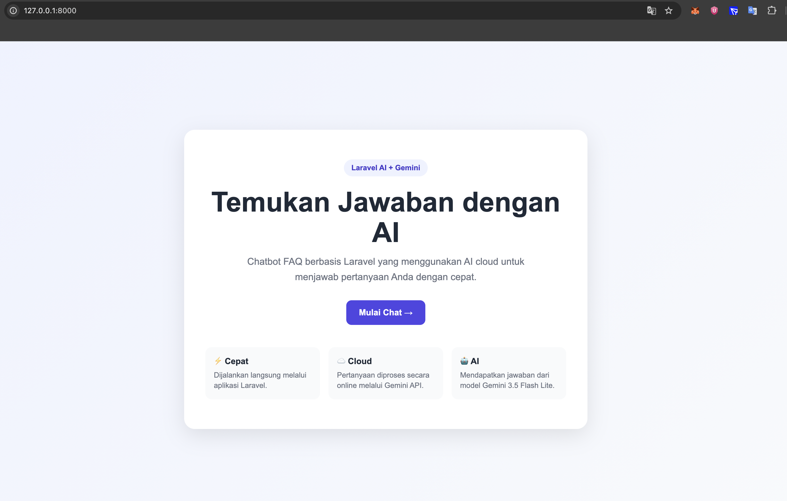
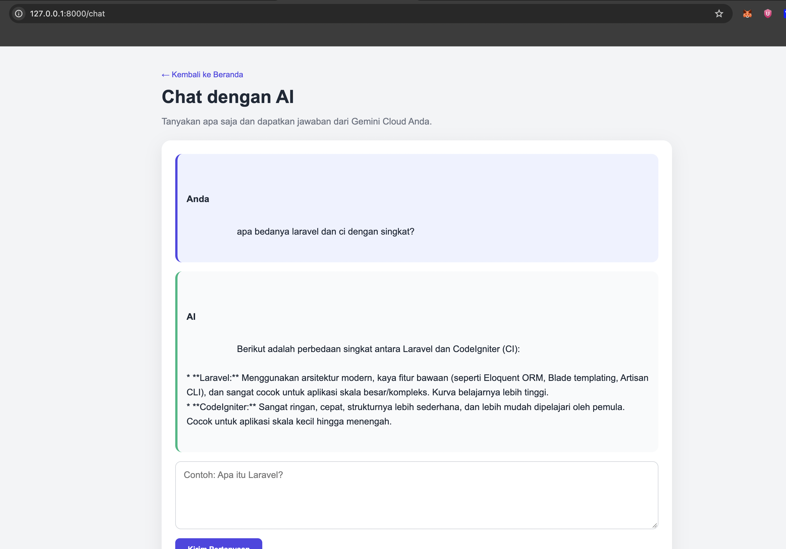

# Laravel AI FAQ Chatbot with Gemini

A simple FAQ chatbot built with Laravel and Google's Gemini API.

This project demonstrates how to use the Laravel AI SDK to connect a Laravel application to a cloud-based large language model.

## Features

- Landing page
- AI chat page
- Indonesian AI responses
- Gemini Cloud integration
- Laravel AI SDK integration
- Simple Blade-based interface
- SQLite database
- No MySQL or Docker required

## Screenshots

### Home Page



### Chat Page



## Technology Stack

- Laravel 13
- PHP 8.4
- Laravel AI SDK
- Blade
- Livewire
- SQLite
- Google Gemini API
- Gemini 3.5 Flash Lite

## Requirements

Make sure the following are installed:

- PHP
- Composer
- Laravel
- A Google AI Studio account
- A Gemini API key

## Installation

Clone the repository:

```bash
git clone <repository-url>
cd laravel-ai-faq-chatbot-gemini
```

Install PHP dependencies:

```bash
composer install
```

Create the environment file:

```bash
cp .env.example .env
```

Generate the Laravel application key:

```bash
php artisan key:generate
```

Add your Gemini API key to `.env`:

```env
GEMINI_API_KEY=your-gemini-api-key
```

Run the database migrations:

```bash
php artisan migrate
```

Start the Laravel development server:

```bash
php artisan serve
```

Open the application at:

```text
http://127.0.0.1:8000
```

The chat page is available at:

```text
http://127.0.0.1:8000/chat
```

## Architecture

```text
Browser
   ↓
Laravel Blade
   ↓
ChatController
   ↓
ChatAgent
   ↓
Laravel AI SDK
   ↓
Gemini API
   ↓
Gemini 3.5 Flash Lite
```

## Environment Variables

```env
APP_NAME=Laravel
APP_ENV=local
APP_KEY=
APP_DEBUG=true
APP_URL=http://localhost

GEMINI_API_KEY=your-gemini-api-key
```

Never commit `.env` or expose your Gemini API key publicly.

## Free Tier

Gemini API provides a free tier with usage limits. Availability, model access, and quotas may change. Check your usage and rate limits in Google AI Studio before using the application extensively.

## Project Structure

```text
app/Ai/Agents/ChatAgent.php
app/Http/Controllers/ChatController.php
resources/views/home.blade.php
resources/views/chat.blade.php
routes/web.php
```

## License

This project is open-sourced under the MIT license.
